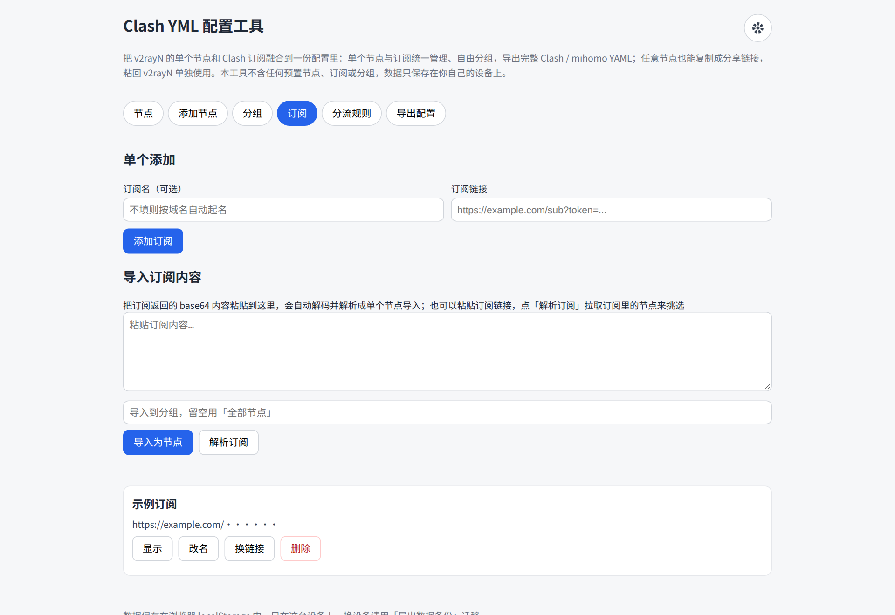

# Clash YML 配置工具

把 **v2rayN 的单个节点**和 **Clash 订阅**融合到一份配置里：在一个工具里统一管理单个节点与订阅，自由分组，一键导出完整的 Clash / mihomo YAML 拿去用；反过来，订阅里的节点也能拆成单个节点，一个一个复制成分享链接，粘回 v2rayN 单独使用。

同一份代码有四种用法：

- **网页版**：部署到任意静态托管后用浏览器打开，手机、电脑都行，可「添加到主屏幕」当 App 用
- **Windows**：Electron 打包的 `.exe`（x64 / ARM64，各有安装版 + 免安装版）
- **Android**：Capacitor 打包的 `.apk`（正式签名版，可覆盖升级；通用版 + 按架构分包）
- **macOS**：Electron 打包的 `.dmg`（Apple Silicon / Intel）

## 下载

到 [Releases 页](https://github.com/Vardven/node-yml-config-tool/releases/latest)下载最新版，按自己的系统和架构选：

| OS | 可选文件 |
| --- | --- |
| Android | APK ARMv8 · APK ARMv7 · APK x64 · 通用版 APK |
| Windows | Setup x64 · Portable x64 · Setup ARM64 · Portable ARM64 |
| macOS | DMG Apple Silicon · DMG Intel X64 |

各文件的区别和装法见下面「使用方法」里对应的系统小节。

## 界面截图

> 截图中的节点均为演示数据（example.com 示例地址），工具本身不含任何预置数据。

节点列表——每个节点可单独「复制链接」粘回 v2rayN：


分组页——上半是 YAML 里的策略组（按地区自动归类，只能查看成员），下半是可自己改名、还能整组移动节点的自定义分组：


订阅页——添加订阅链接用于导出配置；粘贴订阅链接点「解析订阅」直接拉取，或粘贴 Base64 内容解码，把订阅拆成单个节点挑选导入：



导出配置——预览完整 YAML，可下载或复制；还能把全部节点导出成链接清单：


设置页（右上角齿轮进入）——语言切换、检查更新、关于与许可：


## 功能

- **添加节点**：粘贴分享链接自动解析（vless / vmess / trojan / hysteria2 / tuic / anytls / ss），解析结果会列出已识别的参数供核对；一次粘贴多条链接可批量添加；也可以手动填参数。被换行断开的长链接会自动拼回再解析，链接里混有空格也会先清理
- **节点命名**：按「分组名|地点名|地址|端口」自动生成；添加时先按链接备注、再按域名后缀预填国家/地区，CDN 前置和纯 IP 无法确定出口国家时明确提示手动填，不乱猜
- **节点转链接**：每个节点可复制成 v2rayN 分享链接；导出页还能一键复制全部节点链接或下载链接清单（.txt）
- **订阅管理**：单个添加订阅链接（可改名、换链接、删除，链接默认打码显示）；导出配置时每个订阅生成一段 `proxy-providers`，节点自动进入自动选择、负载均衡和各地区策略组
- **解析订阅**：把订阅链接粘到「导入订阅内容」框里点「解析订阅」，工具会直接联网拉取这条订阅，把里面的节点全部列出来，勾选后导入到指定分组。Windows / Android 版走原生网络拉取，不受跨域限制；网页版若被订阅服务器跨域拦截，会明确提示改用下面的粘贴内容方式，不会假装成功
- **导入订阅内容**：把订阅返回的 Base64 内容粘进来，会自动解码并解析成单个节点（标准 / 无填充 / URL 安全字母表 / 双层编码都能识别），解码后无论是链接列表还是 Clash YAML 都能解析，可逐个确认或一键全部添加——订阅里的节点从此也能单独复制回 v2rayN
- **分组**：「分组」页上半部分是导出 YAML 里的**策略组**（全部节点、自动选择、负载均衡、各地区与各服务分组等），与 YAML 模板实时对应，只能查看每个组包含哪些节点，不能改名删除；下半部分是**自定义分组**，可新建、重命名（自动同步组内节点名）、删除，还能用「移动节点」把组内节点整组（或逐个勾选）迁移到另一个分组——订阅导入的一大组节点想换分组时不用一个个改。自定义分组导出时会生成真正的策略组，也能被分流规则选为目标。新节点默认放入内置的「全部节点」
- **分流规则**：「分流规则」页管理导出 YAML 的 rules。默认 22 条规则（基于 MetaCubeX 公开规则集：国内直连、AI、流媒体、各服务分流等）**完全锁定**，目标、顺序都不能改，保证不会误改坏；自己添加的规则完全自由，可删除、用 ↑↓ 任意调序、还能起个名字（名字会作为注释写进导出的 YAML），类型支持 RULE-SET / DOMAIN-SUFFIX / DOMAIN-KEYWORD / DOMAIN / IP-CIDR / GEOIP / MATCH，目标可选任意策略组或自定义分组
- **导出配置**：生成完整 mihomo / Clash YAML（全局设置、嗅探、TUN、DNS、策略组、规则集），可下载 `.yaml` 或一键复制，直接导入 Clash Verge 等客户端。无订阅时导出的配置同样保证可正常导入
- **备份**：全部数据可导出为 JSON 文件备份，换设备时导入恢复
- **设置**：右上角齿轮进入独立设置页，可切换界面语言（简体中文、繁體中文、English、Русский、فارسی、日本語、한국어 共 7 种）、检查更新（启动时自动检查、发现新版弹窗提示，设置页也可手动检查）、查看关于与许可。所有操作结果都会在屏幕底部弹出悬浮提示，在页面任何位置都看得见

## 使用方法

### 网页版（推荐先试这个，不用安装）

网页版就是仓库里的 `www/` 目录，把它放到任何能托管静态网页的地方即可：

### 🚀 一键部署（推荐）

点下面的按钮，会自动把本仓库克隆到你的 GitHub 账号并部署到 Cloudflare，全程不用敲命令（需要一个免费的 Cloudflare 账号）：

[](https://deploy.workers.cloudflare.com/?url=https://github.com/Vardven/node-yml-config-tool)

1. 点按钮后登录 Cloudflare，按提示授权它访问你的 GitHub
2. 确认项目名称（可以改），点部署，等一两分钟
3. 部署成功后会得到一个 `https://<项目名>.<你的子域>.workers.dev` 网址，打开就是网页版
4. 手机上打开该网址，点浏览器菜单里的「添加到主屏幕」，就能当 App 用

**网页版怎么更新？** 一键部署是把代码**复制**一份到你自己的 GitHub 账号里，Cloudflare 只盯着你那份副本——原仓库发新版不会自动流进副本，所以不会自动更新。更新方法（先在工具里导出一份 JSON 备份更稳妥）：

1. 打开你 GitHub 里克隆的那份仓库，点 **Sync fork → Update branch**（把上游新版同步过来）
2. Cloudflare 检测到副本更新后会自动重新部署，等 1~2 分钟，刷新页面就是新版（网址不变，浏览器里的数据还在）
3. 如果仓库里没有 Sync fork 按钮，用 git 也行：`git remote add upstream https://github.com/Vardven/node-yml-config-tool.git` 然后 `git pull upstream main && git push`

**方式一：手动部署到免费静态托管（有自己的网址，手机电脑都能开）**

1. 注册一个静态托管服务，如 Cloudflare Pages、Vercel 或 Netlify（免费版即可）
2. 新建项目，选择上传/导入本仓库（或直接上传 `www` 文件夹），发布目录填 `www`
3. 部署完成后会得到一个网址，用浏览器打开就是网页版
4. 手机上打开该网址后，点浏览器菜单里的「添加到主屏幕」，桌面上会出现图标，用起来和 App 一样

**方式二：只在自己电脑上用（不用部署）**

```bash
npm install
npm run serve
# 浏览器打开 http://localhost:8080
```

或者直接双击打开 `www/index.html` 也能用（推荐用上面的本地服务器方式，数据保存更稳定）。

> 注意：网页版的数据保存在**当前浏览器**的本地存储里。换浏览器、换设备或清掉浏览器数据，数据不会自动跟过去；请定期用「导出配置」页的**导出备份（JSON）**保存数据，换地方时再导入。

### Windows 版

到仓库的 [Releases](https://github.com/Vardven/node-yml-config-tool/releases) 页下载最新版，按电脑架构选（普通电脑都是 x64；ARM 架构的 Windows 设备选 ARM64）：

- `node-yml-config-tool-<版本>-x64-setup.exe` / `-arm64-setup.exe`：安装版，装完从开始菜单打开
- `node-yml-config-tool-<版本>-x64-portable.exe` / `-arm64-portable.exe`：免安装版，双击即用

exe 已做代码签名（自签名证书，发布者 Vardven）；因证书为自签名，首次运行如遇 SmartScreen 提示，点「更多信息 → 仍要运行」。

### Android 版

同样在 [Releases](https://github.com/Vardven/node-yml-config-tool/releases) 页下载：

- `app-release.apk`：**通用版正式签名包，推荐装这个**，不挑架构，以后出新版可直接覆盖升级，不用卸载
- `app-arm64-v8a-release.apk` / `app-armeabi-v7a-release.apk` / `app-x86_64-release.apk`：按架构分开的正式签名包，包体略小，功能完全一样。现在的手机基本都是 ARMv8（arm64-v8a）；老设备选 ARMv7；模拟器多为 x64。不确定就下通用版
- `app-debug.apk`：调试版，也可安装

安装时如系统提示，需要允许「安装未知应用」。下载的 YAML / 备份文件点保存时会弹出系统文件管理器，自己选位置存。v1.0.13 起系统设置里显示的版本号与实际版本一致（此前一直显示模板默认值 1.0，实际功能不受影响）。

### macOS 版

同样在 [Releases](https://github.com/Vardven/node-yml-config-tool/releases) 页下载：

- `node-yml-config-tool-<版本>-arm64.dmg`：Apple Silicon（M1 / M2 / M3 / M4 芯片）
- `node-yml-config-tool-<版本>-x64.dmg`：Intel 芯片

打开 dmg 把应用拖进「应用程序」即可。**注意：macOS 版没有苹果开发者签名**，首次打开如果提示「无法打开，因为无法验证开发者」或应用已损坏，在「访达 → 应用程序」里**右键点应用 → 打开**，在弹窗里再点「打开」；还不行的话在终端执行：

```bash
xattr -dr com.apple.quarantine "/Applications/Clash YML 配置工具.app"
```

之后就能正常打开。

### 基本流程（各版本都一样）

1. **加节点**：「添加节点」页粘贴分享链接（可一次多条），核对解析出的参数和地点，选好分组后添加；没有链接也可以手动填
2. **加订阅**：「订阅」页添加订阅链接，导出配置时整份引用；想把订阅里的节点拆出来单独用，在同页粘贴订阅链接点「解析订阅」拉取后勾选导入，或把订阅的 Base64 内容粘进来解码导入
3. **理分组**：「分组」页查看每个策略组实际包含哪些节点；建自己的分组整理节点，整组换分组用「移动节点」
4. **调规则**（可选）：「分流规则」页添加自己的规则（如让某个域名直连），默认规则不用管
5. **导出用**：「导出配置」页下载 YAML，导入 Clash Verge / mihomo 等客户端使用；想回 v2rayN，就在节点上点「复制链接」或导出全部节点链接
6. **备份**：换设备前在「导出配置」页导出 JSON 备份，新设备上导入

## 隐私：默认完全为空

**本工具不含任何预置数据。** 首次打开时节点 0 个、订阅 0 个、自定义分组 0 个（只有内置的「全部节点」和模板自带的策略组与默认规则），没有任何示例账号、服务器或订阅地址。所有数据只保存在使用者自己设备本地，不上传到任何服务器。把它发给别人用，对方打开也是空白的，只能填他们自己的节点和订阅。

## 本地开发与打包

```bash
npm install
npm run serve   # 网页版本地调试 http://localhost:8080
npm start       # 桌面版调试运行（Electron）
```

打包不用在自己电脑上做：仓库带了三份 GitHub Actions 配置，推送 `v` 开头的标签（如 `v1.0.14`）会自动打包，并把 exe、apk 和 dmg 挂到对应的 Release 里；也可以在 Actions 页手动触发（产物在运行记录的 Artifacts 里）。打包时会自动把 `package.json` 里的版本号写入安卓 APK 的 versionName / versionCode（versionCode 按 主×10000＋次×100＋修 计算，分架构包再按架构加权），各端版本号始终一致。

签名说明：

- **Windows**：exe 用自签名证书签名（发布者 Vardven），能防篡改，但不是受系统信任的商业证书，SmartScreen 仍可能提示，按上文方法放行即可。签名材料通过仓库 Secrets 注入，fork 本项目的人没有这些 Secrets 时打出的是未签名版本，功能不受影响
- **Android**：`app-release.apk` 用正式 keystore 签名，可覆盖升级；keystore 通过仓库 Secrets 注入。没有 Secrets 时请分发 debug 版，不要分发未签名的 release 版（装不上）。keystore 务必妥善保管，丢了就无法给老用户发覆盖升级包

## 项目结构

```text
.
├── www/                        # 网页应用本体（无构建步骤，三端共用）
│   ├── index.html
│   ├── css/style.css
│   ├── js/core.js              # 核心逻辑：链接解析 / 分享链接生成 / 订阅解析 / YAML 生成
│   ├── js/app.js               # 界面与本地存储
│   ├── js/i18n.js              # 7 种界面语言词典
│   ├── manifest.webmanifest    # 可安装到主屏幕的配置
│   └── icon.svg
├── electron/
│   ├── main.js                 # Electron 主进程（含原生拉取订阅的通道）
│   └── preload.js
├── plugins/
│   └── capacitor-save-as/      # 本地 Capacitor 插件：安卓保存文件时调系统另存为对话框
├── capacitor.config.json       # Capacitor 配置（webDir = www，已启用原生 HTTP 拉取）
├── package.json                # 依赖、脚本、electron-builder 打包配置
├── wrangler.jsonc              # Cloudflare 一键部署配置（静态资源指向 www）
├── docs/screenshots/           # README 截图（演示数据）
├── build/
│   └── icon.png                # 桌面应用图标（1024×1024）
├── .github/workflows/
│   ├── build-windows.yml       # 云端打 Windows exe（x64 + ARM64）
│   ├── build-android.yml       # 云端打安卓 apk（自动写入版本号、按架构分包）
│   └── build-macos.yml         # 云端打 macOS dmg（x64 + Apple Silicon，未签名）
├── LICENSE                     # CC BY-NC-SA 4.0
└── README.md
```

安卓的 `android/` 工程文件夹**不包含在源码里**，是打包时由 `npx cap add android` 现场生成的，已写进 `.gitignore`，这是正常现象。

## 许可证

CC BY-NC-SA 4.0（署名-非商业性使用-相同方式共享），见 [LICENSE](LICENSE)。

简单说：可以免费使用、查看和修改源码，但**不得用于商业用途**；使用或修改必须**注明原作者 Vardven 及本仓库地址**；修改后的版本必须以**相同协议**公开发布。

作者：Vardven
